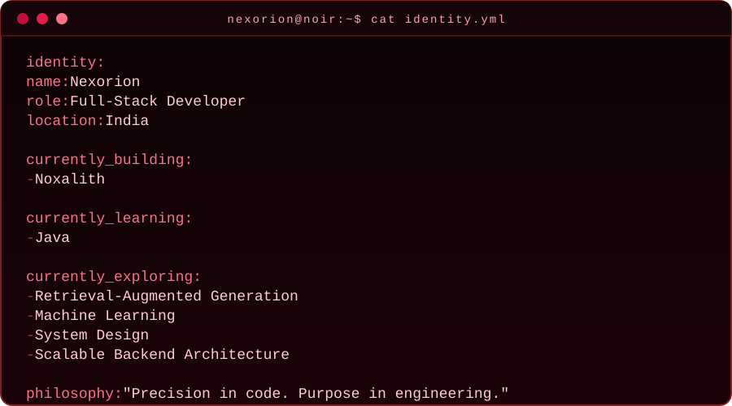

<!-- ====================================================== -->
<!--            NEXORION  |  CRIMSON NOIR  |  v2            -->
<!--   Repo must be named exactly: nexxorion/nexxorion       -->
<!--   Keep the /assets folder next to this README.md        -->
<!-- ====================================================== -->

<picture>
  <source media="(prefers-color-scheme: dark)" srcset="assets/banner-dark.svg">
  <source media="(prefers-color-scheme: light)" srcset="assets/banner-light.svg">
  
</picture>

<a href="https://github.com/nexxorion">
  <picture>
    <source media="(prefers-color-scheme: dark)" srcset="https://readme-typing-svg.demolab.com?font=JetBrains+Mono&weight=600&size=20&duration=3000&pause=1000&color=FB7185&center=true&vCenter=true&width=720&height=40&lines=Engineering+Beyond+Boundaries.;Building+Scalable+Digital+Systems.;Crafting+Code+With+Precision.;Turning+Complexity+Into+Simplicity.">
    <source media="(prefers-color-scheme: light)" srcset="https://readme-typing-svg.demolab.com?font=JetBrains+Mono&weight=600&size=20&duration=3000&pause=1000&color=BE123C&center=true&vCenter=true&width=720&height=40&lines=Engineering+Beyond+Boundaries.;Building+Scalable+Digital+Systems.;Crafting+Code+With+Precision.;Turning+Complexity+Into+Simplicity.">
    
  </picture>
</a>

 

<h2 align="center">⛧ 01 — THE DEVELOPER ⛧</h2>

I'm a <b>Full-Stack Developer from India</b> who builds modern digital products and hunts down meaningful technical problems. 
From sharp frontend experiences to backend architecture, databases and infrastructure — I own the whole lifecycle. 
My obsessions: <b>software architecture · system design · performance · AI-powered applications</b>.

<picture>
  <source media="(prefers-color-scheme: dark)" srcset="assets/identity-dark.svg">
  <source media="(prefers-color-scheme: light)" srcset="assets/identity-light.svg">
  
</picture>

<h2 align="center">🩸 02 — ENGINEERING DOMAINS 🩸</h2>

<table>
<tr>
<td width="50%" valign="top">

### 🗡️ Frontend Engineering
Modern interfaces, responsive experiences, component architecture and frontend performance.

</td>
<td width="50%" valign="top">

### ⚙️ Backend Engineering
API architecture, server-side development, application logic and scalable services.

</td>
</tr>
<tr>
<td width="50%" valign="top">

### 🕸️ Data Engineering
Database design, data management, caching and persistence systems.

</td>
<td width="50%" valign="top">

### 🔥 Infrastructure
Containerization, cloud technologies, Linux environments and deployment workflows.

</td>
</tr>
</table>

<h2 align="center">☠️ 03 — TECHNOLOGY ARSENAL ☠️</h2>

<h3 align="center">⚔️ CORE WEAPONS</h3>

<picture>
  <source media="(prefers-color-scheme: dark)" srcset="https://skillicons.dev/icons?i=react%2Cnodejs%2Cjs%2Chtml%2Ccss%2Ctailwind%2Cmongodb%2Credis%2Cdocker&theme=dark">
  <source media="(prefers-color-scheme: light)" srcset="https://skillicons.dev/icons?i=react%2Cnodejs%2Cjs%2Chtml%2Ccss%2Ctailwind%2Cmongodb%2Credis%2Cdocker&theme=light">
  
</picture>

<h3 align="center">🩸 IN TRAINING</h3>

<picture>
  <source media="(prefers-color-scheme: dark)" srcset="https://skillicons.dev/icons?i=java&theme=dark">
  <source media="(prefers-color-scheme: light)" srcset="https://skillicons.dev/icons?i=java&theme=light">
  
</picture>

<h3 align="center">🕷️ EXTENDED ARSENAL</h3>

<picture>
  <source media="(prefers-color-scheme: dark)" srcset="https://skillicons.dev/icons?i=ts%2Cnextjs%2Cexpress%2Cpostgres%2Cmysql%2Clinux%2Cnginx%2Caws%2Cgit%2Cgithub%2Cpostman&theme=dark">
  <source media="(prefers-color-scheme: light)" srcset="https://skillicons.dev/icons?i=ts%2Cnextjs%2Cexpress%2Cpostgres%2Cmysql%2Clinux%2Cnginx%2Caws%2Cgit%2Cgithub%2Cpostman&theme=light">
  
</picture>

<h2 align="center">🔥 04 — CURRENTLY BUILDING 🔥</h2>

# ☠ NOXALITH ☠

**PRODUCT ENGINEERING · FULL-STACK DEVELOPMENT**

Exploring modern full-stack development, product architecture and practical engineering solutions.

*More projects and technical case studies rising soon.*

<h2 align="center">📈 05 — GITHUB STATISTICS 📈</h2>

<picture>
  <source media="(prefers-color-scheme: dark)" srcset="https://github-readme-stats.vercel.app/api?username=nexxorion&show_icons=true&hide_border=true&bg_color=0D0D0D&title_color=FB7185&icon_color=E11D48&text_color=F8FAFC&rank_icon=github&cache_seconds=14400">
  <source media="(prefers-color-scheme: light)" srcset="https://github-readme-stats.vercel.app/api?username=nexxorion&show_icons=true&hide_border=true&bg_color=FFF5F5&title_color=9F1239&icon_color=E11D48&text_color=27272A&rank_icon=github&cache_seconds=14400">
  
</picture>
<picture>
  <source media="(prefers-color-scheme: dark)" srcset="https://github-readme-stats.vercel.app/api/top-langs/?username=nexxorion&layout=compact&hide_border=true&bg_color=0D0D0D&title_color=FB7185&text_color=F8FAFC&cache_seconds=14400">
  <source media="(prefers-color-scheme: light)" srcset="https://github-readme-stats.vercel.app/api/top-langs/?username=nexxorion&layout=compact&hide_border=true&bg_color=FFF5F5&title_color=9F1239&text_color=27272A&cache_seconds=14400">
  
</picture>

 

<picture>
  <source media="(prefers-color-scheme: dark)" srcset="https://streak-stats.demolab.com?user=nexxorion&hide_border=true&background=0D0D0D&ring=E11D48&fire=FB7185&currStreakLabel=FB7185&sideLabels=F8FAFC&dates=A1A1AA&currStreakNum=FFFFFF&sideNums=FFFFFF">
  <source media="(prefers-color-scheme: light)" srcset="https://streak-stats.demolab.com?user=nexxorion&hide_border=true&background=FFF5F5&ring=9F1239&fire=E11D48&currStreakLabel=9F1239&sideLabels=27272A&dates=71717A&currStreakNum=18181B&sideNums=18181B">
  
</picture>

<h2 align="center">🗡️ 06 — ENGINEERING PHILOSOPHY 🗡️</h2>

<table>
<tr>
<td width="50%" valign="top">

### 01 / PRECISION
Every implementation needs a clear purpose and a clean execution.

</td>
<td width="50%" valign="top">

### 02 / SIMPLICITY
The best solutions cut away everything unnecessary.

</td>
</tr>
<tr>
<td width="50%" valign="top">

### 03 / SCALABILITY
Build for maintainability, performance and future growth.

</td>
<td width="50%" valign="top">

### 04 / EVOLUTION
Never stop learning, experimenting and sharpening the craft.

</td>
</tr>
</table>

<h2 align="center">😈 07 — ESTABLISH CONNECTION 😈</h2>

### Have something ambitious to build?
**Let's turn bold ideas into meaningful software.**

*"Precision in every line. Excellence in every system."*

© NEXORION · ENGINEERED WITH INTENTION

